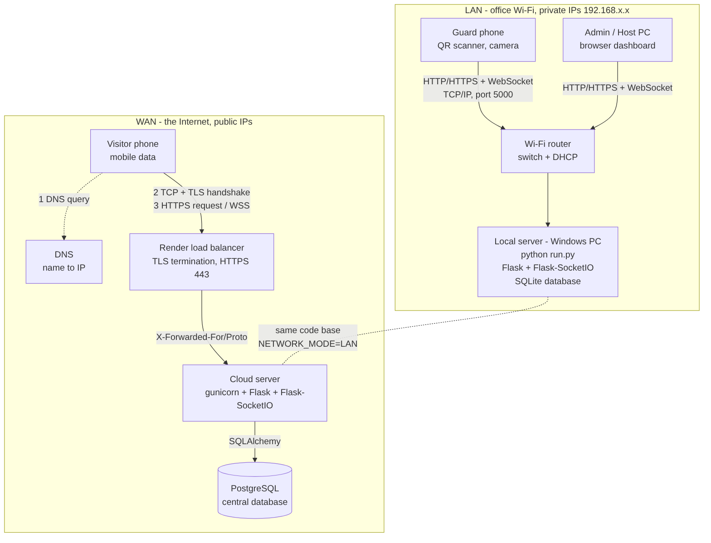
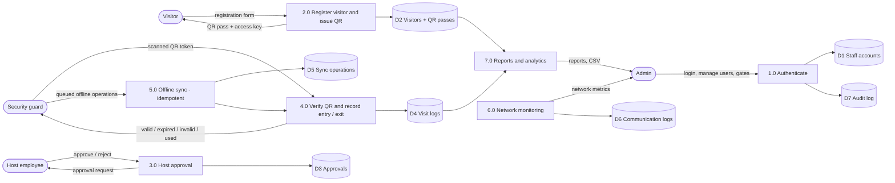
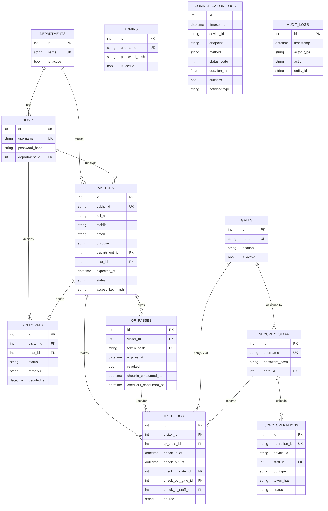
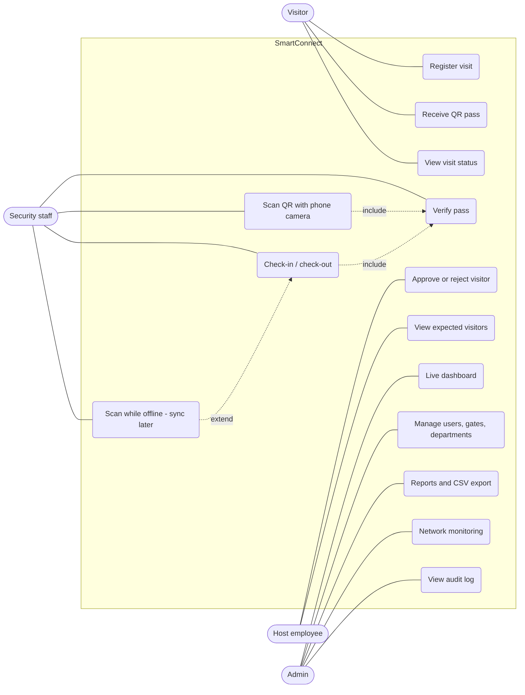
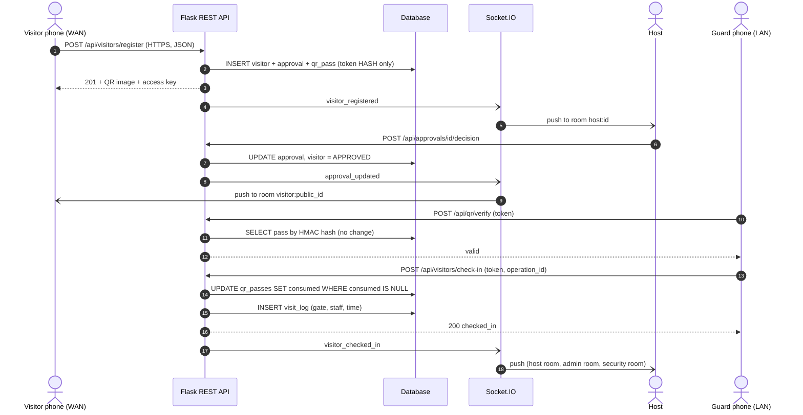
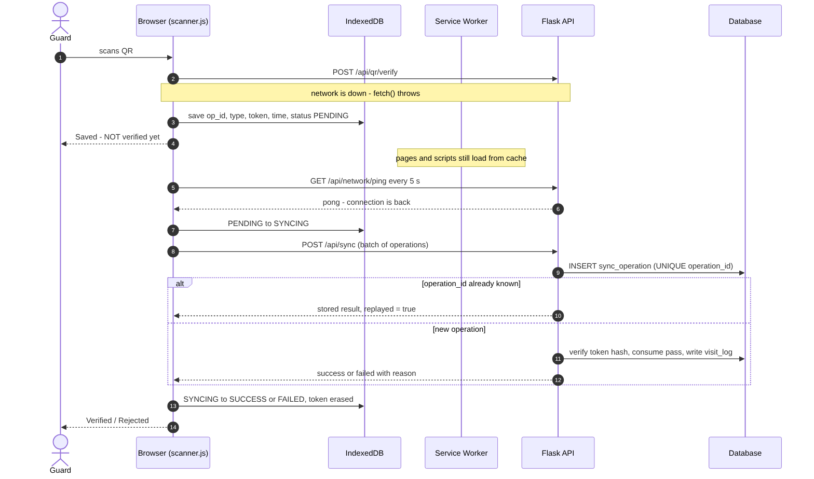
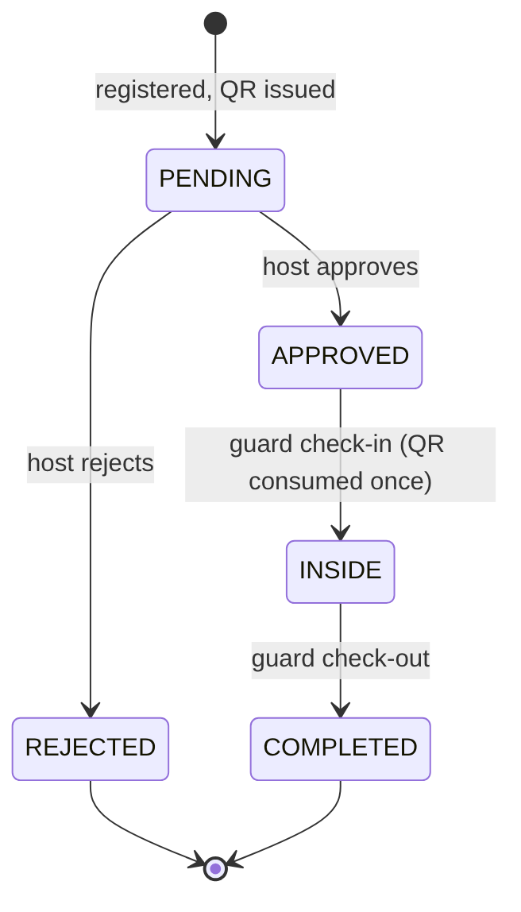
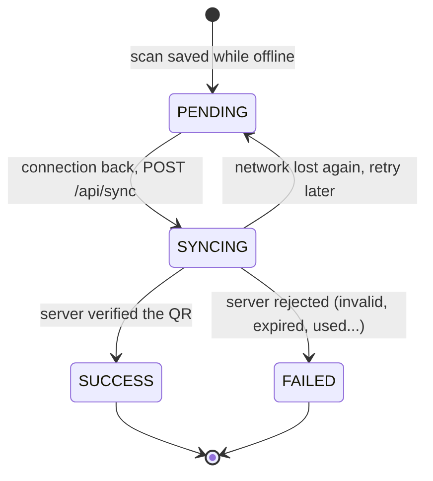

# SmartConnect – QR Code-Based Intelligent Visitor Management System with Dual Network Communication (LAN + WAN)

## 1. Abstract
SmartConnect is a web-based visitor management system. Visitors register online and receive a QR pass; security staff scan it with a phone camera; hosts approve visits; admins watch everything live. The same code runs on a local LAN server and on an Internet (WAN) server, queues scans while offline and synchronises safely later, and measures its own network performance. It demonstrates practical Data Communication concepts: client–server, TCP/IP, HTTP/HTTPS, REST, WebSocket, DNS, TLS, latency and synchronisation.

## 2. Problem statement
Paper visitor registers are slow, unverifiable, leak personal data, give no live view of who is inside, and fail when the network is down.

## 3. Objectives
Online registration; secure expiring one-time QR passes; mobile scanning; host approval; real-time dashboard; LAN and WAN operation; offline queue with duplicate-free synchronisation; network monitoring with real measurements; reports and audit.

## 4. Scope
Single organisation, four roles (Admin, Security, Host, Visitor), multiple gates and departments. Out of scope: SMS/email delivery, face recognition, native mobile apps.

## 5. Existing system
Manual register at the gate: handwriting, no verification, no host consent, no analytics, privacy risk.

## 6. Proposed system
Web application with REST API + WebSocket, SQL database, QR passes (random token, only its HMAC hash stored), PWA offline support, and a monitoring dashboard.

## 7. System architecture

Layers: Browser (HTML/CSS/JS, Bootstrap, html5-qrcode, IndexedDB, Service Worker) → HTTP/HTTPS + WebSocket → Flask routes → services (auth, QR, visits, sync, monitor, reports) → SQLAlchemy → SQLite (LAN) / PostgreSQL (WAN).

## 8. Data flow diagram

## 9. Database ER diagram

Tables: admins, security_staff, hosts, departments, gates, visitors, qr_passes, visit_logs, approvals, communication_logs, sync_operations, audit_logs — with primary/foreign keys, unique constraints, indexes and timestamps. A partial unique index prevents two open visits for one visitor.

## 10. Use case diagram

## 11. Sequence diagrams

## 12. Data Communication concepts – and where to see them
| Concept | Implementation / how to demonstrate |
|---|---|
| Sender & receiver | Phone (sender) → server (receiver); guard → API → host via WebSocket. Network page "request history". |
| Client–server | Browsers are clients; Flask is the server holding the only database. |
| LAN vs WAN | Client IP classified by `classify_ip` (private ranges = LAN, public = WAN); every request is logged with its network type; Network page chart. |
| IP addressing | Server prints its private IP (`get_lan_ips`); phone opens `http://192.168.x.x:5000`. |
| TCP/IP | HTTP and WebSocket both ride on TCP; the server listens on port 5000 (LAN) / 443 (WAN). |
| HTTP / HTTPS | Methods, status codes (200/201/401/403/404/409/422/429/500) recorded per request; HTTPS redirect with `FORCE_HTTPS`. |
| REST | Resource-style JSON endpoints, documented in `API.md`. |
| WebSocket | Flask-SocketIO pushes events instantly; connected clients counted live. |
| DNS | `/api/network/dns?host=` resolves a name and measures lookup time; Render URL uses DNS to find the server. |
| TLS | Render terminates TLS; `scripts/make_cert.py` gives LAN HTTPS; HSTS sent on secure requests. |
| Error handling | Offline queue, retry on reconnect, JSON errors, `/health` returns 503 when DB fails. |
| Synchronisation | `/api/sync` batch with unique `operation_id`; states PENDING → SYNCING → SUCCESS/FAILED. |
| Latency | Browser measures round-trip with `performance.now()`; server adds `X-Response-Time-ms`; Network page shows avg/p50/p95. |
| Request–response | Every call logged: time, device, endpoint, method, status, duration, success. |

## 13. Requirements
Hardware: PC with 4 GB RAM (server), Wi-Fi router, Android/iOS phone with camera. Software: Windows 10/11, Python 3.11/3.12, VS Code, Chrome/Edge/Safari, Git (for Render), PostgreSQL (optional).

## 14. Testing documentation
`pytest` runs 247 tests (files in `tests/`):
| Required case | Test |
|---|---|
| Successful registration / invalid info | `test_visitors_and_qr.py::TestRegistration` |
| QR generation / expired / invalid / reused | `TestQrGeneration`, `TestQrVerification`, `test_entry_exit.py::TestCheckIn` |
| Check-in, duplicate, check-out | `test_entry_exit.py` |
| Unauthorized access | `test_auth.py::TestAuthorisation` |
| LAN / WAN | `test_network.py::TestLanAndWan` |
| Server disconnection | `test_sync_offline.py::TestServerDisconnection`, `test_static_assets.py` (offline queue code) |
| Offline sync / duplicate sync | `test_sync_offline.py::TestOfflineSync` |
| Real-time dashboard | `test_realtime.py` |

Real status at delivery: 99 logic/static tests executed and passed; the 148 database/WebSocket tests were written but must be run on a machine with the dependencies installed. Browser behaviour (camera, Service Worker) must be checked by hand with the demo script.

## 15. Advantages and limitations
Advantages: contactless, private (no personal data in QR), real-time, works offline, same code for LAN/WAN, measurable network. Limitations: camera needs HTTPS; Service Worker needs HTTPS/localhost; offline scans are not trusted until the server verifies them; SQLite for single-server use; no SMS/email notifications.

## 16. Future enhancements
SMS/email pass delivery, face/ID photo capture, Redis for multi-server WebSocket scaling, native apps, blacklist/watch-list, analytics forecasting, badge printing.

## 17. Conclusion
SmartConnect shows how data communication concepts combine in a real system: addressing, transport, application protocols, security, latency measurement and fault-tolerant synchronisation across LAN and WAN.

## 18. References
Flask, Flask-SocketIO, SQLAlchemy, qrcode and html5-qrcode documentation; RFC 9110 (HTTP), RFC 6455 (WebSocket), RFC 8446 (TLS 1.3), RFC 1035 (DNS), RFC 1918 (private addresses); MDN: Service Worker API, IndexedDB; OWASP Cheat Sheets.
